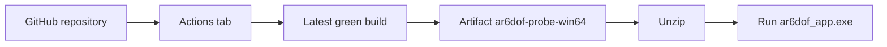

[← Index](index.md) · [Français](../fr/commencer.md)

# Beginner guide: download and run the program

You do **not** compile anything on your PC. GitHub builds the Windows programs for you; you download the result.

## Step 1: sign in to GitHub
Downloading a build result needs a **free GitHub account** (github.com > *Sign up*). Without being signed in, the download link does not appear.

## Step 2: find the Actions tab
1. Open the repository page on github.com.
2. In the bar just under the repository name you see: **Code · Issues · Pull requests · Actions · ...**
3. Click **Actions**.

If you **forked** the repository, GitHub may show a green banner *"I understand my workflows, go ahead and enable them"*: click it once, otherwise nothing is built.

## Step 3: open the latest successful build
1. On the left, click **build-windows**.
2. In the list, take the most recent row with a **green check**. A red cross means the build failed; take the previous green row.
3. A spinning yellow dot means it is still running (the first time, plan for tens of minutes because OpenCV gets compiled; later builds are shorter thanks to the cache).

## Step 4: start a build yourself (optional)
A build starts on its own when `src/`, `CMakeLists.txt`, `vcpkg.json` or `calibration/` change. To start one on demand: **Actions > build-windows > grey *Run workflow* button (right) > *Run workflow***. Wait for the green check.

## Step 5: download
1. Click the green row to open the build.
2. **Scroll to the very bottom** of the page: **Artifacts** section.
3. Click **ar6dof-probe-win64**: a `.zip` file downloads.

GitHub **deletes artifacts after 90 days** (default): start a new build if the download is gone.

## Step 6: unzip and run
1. **Right-click the zip > Extract All...** into a simple folder such as `C:\AR6DoF`. Do not run the program from inside the zip.
2. If Windows blocked the file: right-click the zip **before** extracting > *Properties* > tick **Unblock** > OK.
3. Double-click **`ar6dof_app.exe`**. Windows may show *"Windows protected your PC"* (the program is not signed): click **More info**, then **Run anyway**.

The folder holds `ar6dof_app.exe` (control window), `ar6dof_probe.exe` (tracking engine), `ar6dof_audio.exe` (audio), `ar6dof_screen.dll` (screen capture for Unity) and `calibration/`. **Keep them together.**

## Step 7: first setup in ar6dof_app.exe
1. **Language**: list at the bottom right.
2. **Camera** page: pick your camera (*dual module* if one camera gives left | right, otherwise *two separate cameras*) and a **Mode** (resolution and frame rate; "recommended" is marked in the list).
3. **Sensors** page: pick the IMU **serial port**, then *Calibrate mounting* (once).
4. Click **Save**.
5. **Calibration** page: follow the [calibration guide](calibration.md).
6. To test: **Tracking** page > *Start tracking*.

Eye tracking, mouth and audio are **off by default**: leave the boxes unticked if you do not have the hardware.

## Step 8: Unity
Follow [unity/README_UNITY.md](../../unity/README_UNITY.md) (French): copy the `Assets/AR6DoF` folder, menu *AR6DoF > Creer la scene complete*.

## It does not work?
- **No Actions tab:** you may not be on the GitHub repository, or Actions are disabled in *Settings > Actions* (forked repository).
- **No Artifacts section:** the build has not finished or failed (red cross); open it to read the error and pick a green build.
- **No download button:** sign in to GitHub.
- **Anything else:** [troubleshooting (French)](../fr/reference/depannage.md).
