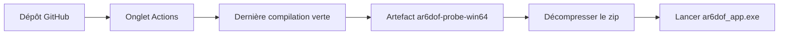

[← Index](index.md) · [English](../en/getting-started.md)

# Guide débutant : télécharger et lancer le programme

Tu n'as **rien à compiler** sur ton PC. GitHub compile les programmes Windows pour toi ; tu télécharges le résultat.

## Étape 1 : se connecter à GitHub
Télécharger un résultat de compilation demande un **compte GitHub gratuit** (github.com > *Sign up*). Sans compte connecté, le bouton de téléchargement n'apparaît pas.

## Étape 2 : trouver l'onglet Actions
1. Ouvre la page du dépôt sur github.com.
2. Dans la barre juste sous le nom du dépôt, tu vois : **Code · Issues · Pull requests · Actions · ...**
3. Clique sur **Actions**.

Si tu as **copié le dépôt** (*Fork*), GitHub peut afficher un bandeau vert *« I understand my workflows, go ahead and enable them »* : clique dessus une fois, sinon rien ne se compile.

## Étape 3 : ouvrir la dernière compilation réussie
1. À gauche, clique sur **build-windows**.
2. Dans la liste, prends la ligne la plus récente avec une **coche verte**. Une croix rouge = la compilation a échoué ; prends la ligne verte précédente.
3. Une pastille jaune qui tourne = encore en cours (la première fois, compte plusieurs dizaines de minutes car OpenCV est compilé ; ensuite c'est plus court grâce au cache).

## Étape 4 : lancer une compilation soi-même (facultatif)
La compilation démarre seule quand `src/`, `CMakeLists.txt`, `vcpkg.json` ou `calibration/` changent. Pour en lancer une à la demande : **Actions > build-windows > bouton gris *Run workflow* (à droite) > *Run workflow***. Attends la coche verte.

## Étape 5 : télécharger
1. Clique sur la ligne verte pour ouvrir la compilation.
2. **Descends tout en bas** de la page : section **Artifacts**.
3. Clique sur **ar6dof-probe-win64** : un fichier `.zip` se télécharge.

Les artefacts sont **effacés par GitHub après 90 jours** (réglage par défaut) : relance une compilation si la ligne n'a plus de téléchargement.

## Étape 6 : décompresser et lancer
1. **Clic droit sur le zip > Extraire tout...** dans un dossier simple, par exemple `C:\AR6DoF`. Ne lance pas le programme depuis l'intérieur du zip.
2. Si Windows a bloqué le fichier : clic droit sur le zip **avant** de l'extraire > *Propriétés* > coche **Débloquer** > OK.
3. Double-clique **`ar6dof_app.exe`**. Windows peut afficher *« Windows a protégé votre ordinateur »* (le programme n'est pas signé) : clique **Informations complémentaires** puis **Exécuter quand même**.

Le dossier contient : `ar6dof_app.exe` (fenêtre de contrôle), `ar6dof_probe.exe` (moteur de suivi), `ar6dof_audio.exe` (audio), `ar6dof_screen.dll` (capture d'écran pour Unity) et `calibration/`. **Garde-les ensemble.**

## Étape 7 : premier réglage dans ar6dof_app.exe
1. **Langue** : liste en bas à droite.
2. Page **Caméra** : choisis ta caméra (*un module double* si une seule caméra donne gauche | droite, sinon *deux caméras séparées*) et un **Mode** (résolution et cadence ; « recommandé » est indiqué dans la liste).
3. Page **Capteurs** : choisis le **port série** de l'IMU, puis *Calibrer le montage* (une seule fois).
4. Clique **Enregistrer**.
5. Page **Calibration** : suis le [guide de calibration](calibration.md).
6. Pour tester : page **Suivi** > *Démarrer le suivi*.

Eye tracking, bouche et audio sont **désactivés par défaut** : laisse les cases décochées si tu n'as pas le matériel.

## Étape 8 : Unity
Suis [unity/README_UNITY.md](../../unity/README_UNITY.md) (copier le dossier `Assets/AR6DoF`, menu *AR6DoF > Creer la scene complete*).

## Ça ne marche pas ?
- **Pas d'onglet Actions** : tu es peut-être sur un site qui n'est pas le dépôt GitHub, ou les Actions sont désactivées dans *Settings > Actions* (dépôt copié).
- **Pas de section Artifacts** : la compilation n'a pas fini ou a échoué (croix rouge) ; ouvre-la pour lire l'erreur et prends une compilation verte.
- **Pas de bouton de téléchargement** : connecte-toi à GitHub.
- **Autre problème** : [dépannage](reference/depannage.md).
